# Praktikum 8 PHP dan Database MySQL
 
Repository ini disusun untuk memenuhi tugas **Praktikum 8 - PHP dan Database MySQL** pada mata kuliah Pemrograman Web.
 
**Identitas Mahasiswa:**
- **Nama:** Gama Daya Laksana
- **NIM:** 312510051
- **Kelas:** I253A
- **Program Studi:** Teknik Informatika
- **Dosen Pengampu:** Agung Nugroho, S.Kom., M.Kom.
- **Kampus:** Universitas Pelita Bangsa
---
 
## Tujuan
 
1. Mahasiswa mampu memahami konsep dasar database.
2. Mahasiswa mampu memahami konsep dasar CRUD (*Create, Read, Update, Delete*) menggunakan PHP.
3. Mahasiswa mampu membuat program CRUD sederhana menggunakan PHP dan MySQL.
## Perangkat yang dibutuhkan
 
- XAMPP (Apache, MySQL/MariaDB, PHP).
- Browser web.
- Editor kode, misalnya Visual Studio Code.
## Struktur file
 
```text
Lab8Web/
├── lab8_php_database/
│   ├── koneksi.php      # Koneksi ke database MySQL
│   ├── index.php        # Menampilkan data barang (Read)
│   ├── tambah.php       # Form dan proses tambah data (Create)
│   ├── ubah.php         # Form dan proses ubah data (Update)
│   ├── hapus.php        # Proses hapus data (Delete)
│   ├── gambar/          # Folder penyimpanan gambar barang
│   └── screenshots/     # Capture hasil di browser
└── README.md            # Panduan proyek dan penjelasan tiap langkah
```
 
Folder `lab8_php_database` diletakkan pada *document root* web server (`C:\xampp\htdocs`), lalu diakses melalui `http://localhost/lab8_php_database/`.
 
---
 
## Langkah-langkah Praktikum
 
### 1. Menjalankan MySQL Server
 
Buka **XAMPP Control Panel**, lalu klik tombol **Start** pada modul **Apache** dan **MySQL**. Keduanya harus berstatus *running* (berwarna hijau) agar PHP dapat berjalan dan terhubung ke database.
 
**Capture hasil**
 
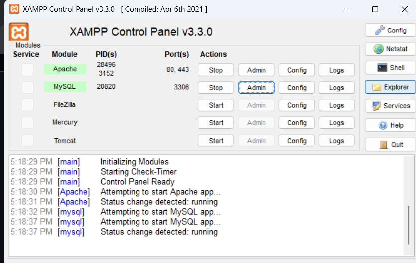
 
---
 
### 2. Mengakses MySQL Client menggunakan phpMyAdmin
 
phpMyAdmin adalah aplikasi berbasis web untuk mengelola database MySQL. Setelah Apache dan MySQL berjalan, buka alamat berikut di browser:
 
```text
http://localhost/phpmyadmin/
```
 
**Capture hasil**
 
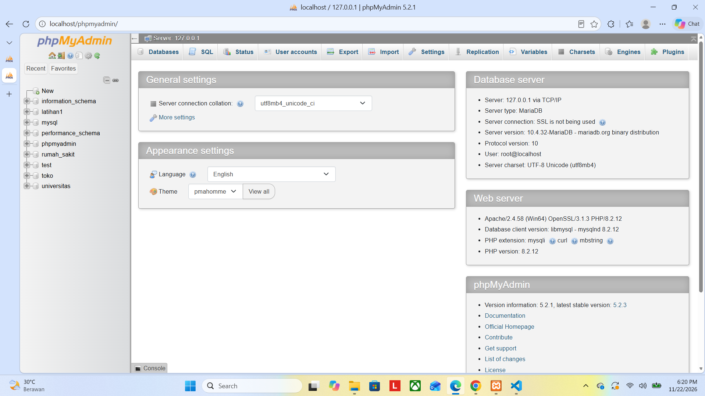
 
---
 
### 3. Membuat Database
 
Studi kasus yang digunakan adalah **Data Barang**. Database dibuat dengan nama `latihan1` melalui tab **SQL** pada phpMyAdmin.
 
```sql
CREATE DATABASE latihan1;
```
 
**Capture hasil**
 
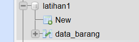
 
---
 
### 4. Membuat Tabel
 
Tabel `data_barang` dibuat di dalam database `latihan1` dengan rancangan field berikut.
 
| Nama Field | Tipe Data | Ukuran | Keterangan |
|---|---|---|---|
| id_barang | INT | 10 | Primary Key, Auto Increment |
| kategori | VARCHAR | 30 | |
| nama | VARCHAR | 30 | |
| gambar | VARCHAR | 100 | |
| harga_beli | DECIMAL | 10 | |
| harga_jual | DECIMAL | 10 | |
| stok | INT | 4 | |
 
```sql
CREATE TABLE data_barang (
  id_barang int(10) auto_increment Primary Key,
  kategori varchar(30),
  nama varchar(30),
  gambar varchar(100),
  harga_beli decimal(10,0),
  harga_jual decimal(10,0),
  stok int(4)
);
```
 
**Capture hasil**
 
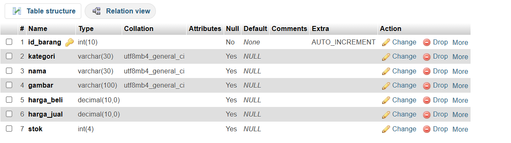
 
---
 
### 5. Menambahkan Data
 
Data awal dimasukkan ke tabel `data_barang` menggunakan perintah `INSERT INTO`. Kolom `id_barang` tidak diisi karena terisi otomatis oleh *auto increment*.
 
```sql
INSERT INTO data_barang (kategori, nama, gambar, harga_beli, harga_jual, stok)
VALUES ('Elektronik', 'HP Samsung Android', 'hp_samsung.jpg', 2000000, 2400000, 5),
('Elektronik', 'HP Xiaomi Android', 'hp_xiaomi.jpg', 1000000, 1400000, 5),
('Elektronik', 'HP OPPO Android', 'hp_oppo.jpg', 1800000, 2300000, 5);
```
 
**Capture hasil**
 
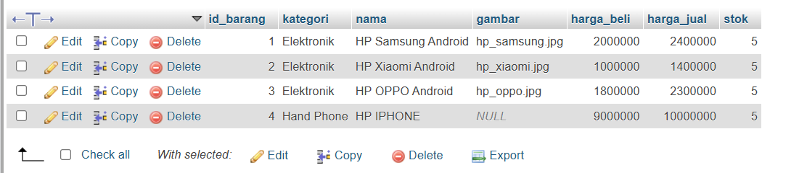
 
---
 
### 6. Membuat Folder Program CRUD
 
Buat folder `lab8_php_database` pada *root directory* web server (`C:\xampp\htdocs`). Di dalamnya, buat juga folder `gambar` untuk menyimpan file gambar barang. Folder diakses melalui:
 
```text
http://localhost/lab8_php_database/
```
 
 
### 7. Membuat File Koneksi Database (`koneksi.php`)
 
File ini menghubungkan PHP ke MySQL menggunakan `mysqli_connect()` dengan host `localhost`, user `root`, password kosong (bawaan XAMPP), dan database `latihan1`. Jika koneksi gagal, program menampilkan pesan error lalu berhenti dengan `die()`.
 
Untuk menguji koneksi, hapus tanda `#` pada bagian `echo "Koneksi berhasil";`, lalu buka `koneksi.php` di browser.
 
```php
<?php
$host = "localhost";
$user = "root";
$pass = "";
$db   = "latihan1";
 
$conn = mysqli_connect($host, $user, $pass, $db);
if ($conn == false)
{
    echo "Koneksi ke server gagal.";
    die();
} #else echo "Koneksi berhasil";
?>
```
 
**Capture hasil**
 
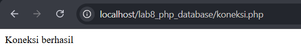
 
---
 
### 8. Menampilkan Data (Read) — `index.php`
 
File ini mengambil seluruh data dari tabel `data_barang` dengan `SELECT * FROM data_barang`, lalu menampilkannya dalam tabel HTML menggunakan perulangan `while` dan `mysqli_fetch_array()`. Setiap baris memiliki tautan **Ubah** dan **Hapus** yang membawa `id_barang` melalui parameter URL, serta tautan **Tambah Barang** di atas tabel.
 
```php
<?php
include("koneksi.php");
 
// query untuk menampilkan data
$sql = 'SELECT * FROM data_barang';
$result = mysqli_query($conn, $sql);
?>
<!DOCTYPE html>
<html lang="en">
<head>
    <meta charset="UTF-8">
    <link href="style.css" rel="stylesheet" type="text/css" />
    <title>Data Barang</title>
</head>
<body>
    <div class="container">
        <h1>Data Barang</h1>
        <div class="main">
            <a href="tambah.php">Tambah Barang</a>
            <table>
                <tr>
                    <th>Gambar</th>
                    <th>Nama Barang</th>
                    <th>Kategori</th>
                    <th>Harga Beli</th>
                    <th>Harga Jual</th>
                    <th>Stok</th>
                    <th>Aksi</th>
                </tr>
                <?php if($result): ?>
                <?php while($row = mysqli_fetch_array($result)): ?>
                <tr>
                    <td>" alt="<?= $row['nama']; ?>"></td>
                    <td><?= $row['nama']; ?></td>
                    <td><?= $row['kategori']; ?></td>
                    <td><?= $row['harga_beli']; ?></td>
                    <td><?= $row['harga_jual']; ?></td>
                    <td><?= $row['stok']; ?></td>
                    <td>
                        <a href="ubah.php?id=<?= $row['id_barang']; ?>">Ubah</a>
                        <a href="hapus.php?id=<?= $row['id_barang']; ?>">Hapus</a>
                    </td>
                </tr>
                <?php endwhile; else: ?>
                <tr>
                    <td colspan="7">Belum ada data</td>
                </tr>
                <?php endif; ?>
            </table>
        </div>
    </div>
</body>
</html>
```
 
**Capture hasil**
 
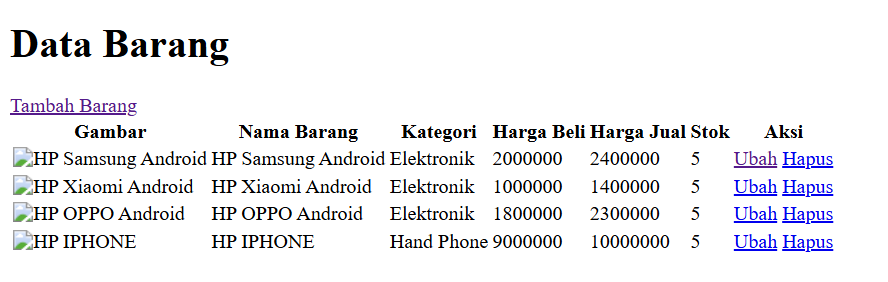
 
---
 
### 9. Menambah Data (Create) — `tambah.php`
 
File ini berisi form input barang dan proses penyimpanannya. Ketika tombol **Simpan** ditekan (`$_POST['submit']`), PHP mengambil data form, memindahkan file gambar yang diunggah ke folder `gambar/` dengan `move_uploaded_file()`, lalu menyimpan data ke database dengan `INSERT INTO`. Setelah selesai, halaman diarahkan kembali ke `index.php`.
 
Form harus memakai `enctype="multipart/form-data"` agar file dapat diunggah.
 
```php
<?php
error_reporting(E_ALL);
include_once 'koneksi.php';
 
if (isset($_POST['submit']))
{
    $nama = $_POST['nama'];
    $kategori = $_POST['kategori'];
    $harga_jual = $_POST['harga_jual'];
    $harga_beli = $_POST['harga_beli'];
    $stok = $_POST['stok'];
    $file_gambar = $_FILES['file_gambar'];
    $gambar = null;
 
    if ($file_gambar['error'] == 0)
    {
        $filename = str_replace(' ', '_', $file_gambar['name']);
        $destination = dirname(__FILE__) . '/gambar/' . $filename;
        if (move_uploaded_file($file_gambar['tmp_name'], $destination))
        {
            $gambar = 'gambar/' . $filename;
        }
    }
 
    $sql = 'INSERT INTO data_barang (nama, kategori, harga_jual, harga_beli, stok, gambar) ';
    $sql .= "VALUE ('{$nama}', '{$kategori}', '{$harga_jual}', '{$harga_beli}', '{$stok}', '{$gambar}')";
    $result = mysqli_query($conn, $sql);
    header('location: index.php');
}
?>
<!DOCTYPE html>
<html lang="en">
<head>
    <meta charset="UTF-8">
    <link href="style.css" rel="stylesheet" type="text/css" />
    <title>Tambah Barang</title>
</head>
<body>
<div class="container">
    <h1>Tambah Barang</h1>
    <div class="main">
        <form method="post" action="tambah.php" enctype="multipart/form-data">
            <div class="input">
                <label>Nama Barang</label>
                <input type="text" name="nama" />
            </div>
            <div class="input">
                <label>Kategori</label>
                <select name="kategori">
                    <option value="Komputer">Komputer</option>
                    <option value="Elektronik">Elektronik</option>
                    <option value="Hand Phone">Hand Phone</option>
                </select>
            </div>
            <div class="input">
                <label>Harga Jual</label>
                <input type="text" name="harga_jual" />
            </div>
            <div class="input">
                <label>Harga Beli</label>
                <input type="text" name="harga_beli" />
            </div>
            <div class="input">
                <label>Stok</label>
                <input type="text" name="stok" />
            </div>
            <div class="input">
                <label>File Gambar</label>
                <input type="file" name="file_gambar" />
            </div>
            <div class="submit">
                <input type="submit" name="submit" value="Simpan" />
            </div>
        </form>
    </div>
</div>
</body>
</html>
```
 
**Capture hasil**
 
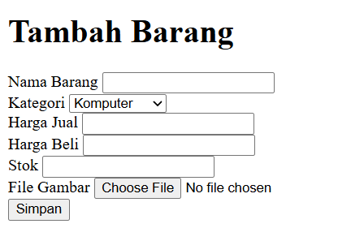
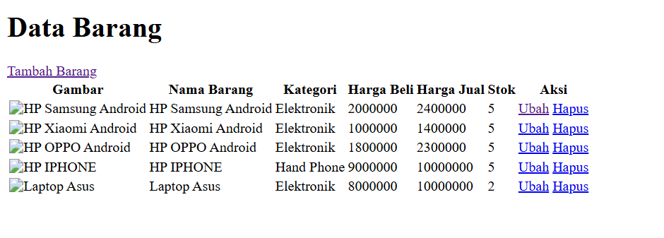
 
---
 
### 10. Mengubah Data (Update) — `ubah.php`
 
File ini bekerja dalam dua tahap:
 
1. **Menampilkan data lama.** `id` diambil dari URL (`$_GET['id']`), datanya dibaca dari database, lalu dimasukkan ke dalam form sebagai nilai awal. Fungsi `is_select()` dipakai untuk menandai kategori yang sedang terpilih pada elemen `<select>`.
2. **Menyimpan perubahan.** Saat tombol **Simpan** ditekan, perintah `UPDATE` dijalankan berdasarkan `id_barang` (dikirim lewat input `hidden`). Kolom `gambar` hanya diperbarui jika ada file baru yang diunggah.
```php
<?php
error_reporting(E_ALL);
include_once 'koneksi.php';
 
if (isset($_POST['submit']))
{
    $id = $_POST['id'];
    $nama = $_POST['nama'];
    $kategori = $_POST['kategori'];
    $harga_jual = $_POST['harga_jual'];
    $harga_beli = $_POST['harga_beli'];
    $stok = $_POST['stok'];
    $file_gambar = $_FILES['file_gambar'];
    $gambar = null;
 
    if ($file_gambar['error'] == 0)
    {
        $filename = str_replace(' ', '_', $file_gambar['name']);
        $destination = dirname(__FILE__) . '/gambar/' . $filename;
        if (move_uploaded_file($file_gambar['tmp_name'], $destination))
        {
            $gambar = 'gambar/' . $filename;
        }
    }
 
    $sql = 'UPDATE data_barang SET ';
    $sql .= "nama = '{$nama}', kategori = '{$kategori}', ";
    $sql .= "harga_jual = '{$harga_jual}', harga_beli = '{$harga_beli}', stok = '{$stok}' ";
    if (!empty($gambar))
        $sql .= ", gambar = '{$gambar}' ";
    $sql .= "WHERE id_barang = '{$id}'";
    $result = mysqli_query($conn, $sql);
    header('location: index.php');
}
 
$id = $_GET['id'];
$sql = "SELECT * FROM data_barang WHERE id_barang = '{$id}'";
$result = mysqli_query($conn, $sql);
if (!$result) die('Error: Data tidak tersedia');
$data = mysqli_fetch_array($result);
 
function is_select($var, $val) {
    if ($var == $val) return 'selected="selected"';
    return false;
}
?>
<!DOCTYPE html>
<html lang="en">
<head>
    <meta charset="UTF-8">
    <link href="style.css" rel="stylesheet" type="text/css" />
    <title>Ubah Barang</title>
</head>
<body>
<div class="container">
    <h1>Ubah Barang</h1>
    <div class="main">
        <form method="post" action="ubah.php" enctype="multipart/form-data">
            <div class="input">
                <label>Nama Barang</label>
                <input type="text" name="nama" value="<?php echo $data['nama']; ?>" />
            </div>
            <div class="input">
                <label>Kategori</label>
                <select name="kategori">
                    <option <?php echo is_select('Komputer', $data['kategori']); ?> value="Komputer">Komputer</option>
                    <option <?php echo is_select('Elektronik', $data['kategori']); ?> value="Elektronik">Elektronik</option>
                    <option <?php echo is_select('Hand Phone', $data['kategori']); ?> value="Hand Phone">Hand Phone</option>
                </select>
            </div>
            <div class="input">
                <label>Harga Jual</label>
                <input type="text" name="harga_jual" value="<?php echo $data['harga_jual']; ?>" />
            </div>
            <div class="input">
                <label>Harga Beli</label>
                <input type="text" name="harga_beli" value="<?php echo $data['harga_beli']; ?>" />
            </div>
            <div class="input">
                <label>Stok</label>
                <input type="text" name="stok" value="<?php echo $data['stok']; ?>" />
            </div>
            <div class="input">
                <label>File Gambar</label>
                <input type="file" name="file_gambar" />
            </div>
            <div class="submit">
                <input type="hidden" name="id" value="<?php echo $data['id_barang']; ?>" />
                <input type="submit" name="submit" value="Simpan" />
            </div>
        </form>
    </div>
</div>
</body>
</html>
```
 
**Capture hasil**
 
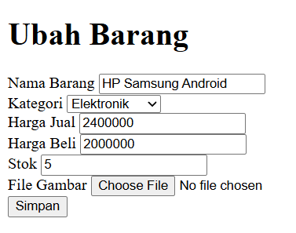
 
---
 
### 11. Menghapus Data (Delete) — `hapus.php`
 
File ini mengambil `id` dari URL, menjalankan perintah `DELETE` pada baris dengan `id_barang` tersebut, lalu mengarahkan kembali ke `index.php`. File ini dipanggil lewat tautan **Hapus** pada tabel data.
 
```php
<?php
include_once 'koneksi.php';
 
$id = $_GET['id'];
$sql = "DELETE FROM data_barang WHERE id_barang = '{$id}'";
$result = mysqli_query($conn, $sql);
header('location: index.php');
?>
```
 
**Capture hasil**
 
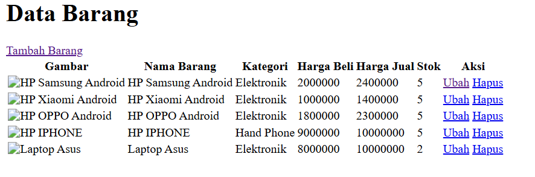
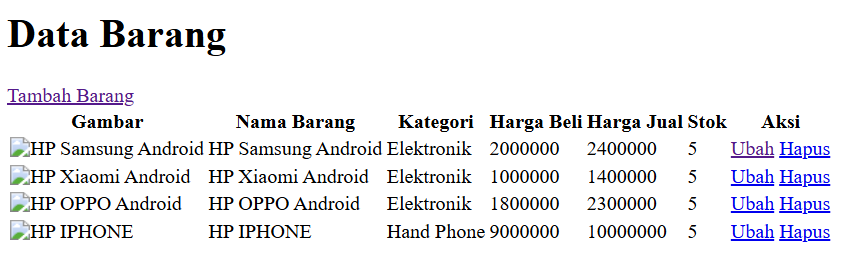
 
---
 
## Catatan
 
- Seluruh query pada praktikum ini masih menyisipkan input langsung ke dalam SQL, sehingga rentan terhadap **SQL Injection**. Untuk aplikasi nyata, gunakan *prepared statement* (`mysqli_prepare()` / `bind_param()`) atau minimal `mysqli_real_escape_string()`.
- Nilai yang ditampilkan dari database sebaiknya dibungkus `htmlspecialchars()` untuk mencegah XSS.
- Pada kode modul terdapat beberapa bagian yang disesuaikan agar program berjalan sesuai tampilan hasil: kolom **Aksi** pada `index.php` berisi tautan Ubah/Hapus (bukan hanya `id_barang`), tautan **Tambah Barang** ditambahkan, urutan kolom header disamakan dengan datanya, `enctype` pada `ubah.php` diperbaiki menjadi `multipart/form-data`, dan fungsi `is_select()` memakai nilai pembanding yang sesuai dengan setiap opsi kategori.
